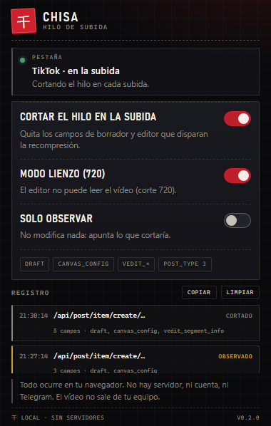

# Chisa · hilo de subida

> Extensión de navegador que corta el hilo entre tu subida y la recompresión de
> TikTok. Todo ocurre en tu equipo: **sin servidores, sin cuentas, sin Telegram**.
> El vídeo no se sube a ningún sitio que no sea TikTok.

**Descarga:** <https://blues-os.github.io/ChisaUploader/chisa-ext-0.2.0.zip> ·
**Web:** <https://blues-os.github.io/ChisaUploader/> ·
**Código:** <https://github.com/BlueS-OS/ChisaUploader>

Es la parte «de subida» del taller de Chisa. El sellado del MP4 sigue viviendo en
[Chisa · taller de hilos](https://blues-os.github.io/BlueChisa/); esto es lo que
ocurre justo antes de pulsar «Publicar».



---

## Qué hace

TikTok decide si un vídeo pasa por su editor en la nube (y por tanto si lo
recomprime) mirando el JSON que la web envía al publicar. La extensión limpia ese
JSON antes de que salga:

| Regla | Qué quita o fuerza |
|---|---|
| `draft` | el objeto de borrador que arrastra el editor |
| `canvas_config` | la configuración del lienzo en la nube |
| `vedit_segment_info` | metadatos del editor de vídeo |
| `cloud_edit_is_use_video_canvas` | se fuerza a `false` |
| `post_type` | si vale `2`, pasa a `3` |

Solo se toca el cuerpo si trae alguna de estas raíces en el **primer nivel**:
`single_post_req_list`, `vedit_common_info` o `post_common_info`. A partir de ahí
se recorre el objeto entero.

No toca el vídeo, ni el bitrate, ni la resolución, ni el códec. Solo el cuerpo
JSON de la petición.

### Modo lienzo (720)

El JSON no basta: el editor web también abre el archivo con
`URL.createObjectURL` para pasarlo por su lienzo en la nube. Con **Modo lienzo**
encendido (por defecto), en las páginas de subida esa función devuelve siempre un
blob inofensivo de 8 bytes. El editor no puede leer el vídeo, así que publica el
archivo tal cual.

Es la misma jugada que hace el modo 720 de otras herramientas, pero aquí sin
servidor: el blob se crea en tu navegador y el vídeo sigue en tu equipo. Si algo
raro pasa con la vista previa, apaga el interruptor y Chisa solo cortará el JSON.

### Cómo lo engancha

- `page.js` corre en el mundo de la página y envuelve **`fetch`**,
  **`XMLHttpRequest`** y **`URL.createObjectURL`**.
- Solo actúa en peticiones **del mismo origen** (o de `*.tiktok.com`) y solo si el
  cuerpo es JSON y contiene alguna de las claves de arriba. Un JSON cualquiera de
  la página se queda intacto.
- Si algo falla, se envía el cuerpo original: nunca rompe la subida.
- `content.js` hace de puente con `chrome.storage` y guarda el registro.
- `popup.js` pinta el estado y el registro. No hay `background` ni servicios
  remotos.

---

## Instalar

Dos caminos, el mismo resultado. El zip solo ahorra el `git clone`.

**Con el zip** (recomendado):

1. Descarga <https://blues-os.github.io/ChisaUploader/chisa-ext-0.2.0.zip> y
   descomprímelo en una carpeta fija.
2. Abre `edge://extensions` (o `chrome://extensions`).
3. Activa **Modo de desarrollador**.
4. Pulsa **Cargar descomprimida** y elige la carpeta `chisa-ext` que salió del zip.
5. Fija la extensión en la barra si quieres verla siempre.

**Desde el código:** clona el repo y elige esta carpeta en el paso 4.

No hay tienda, ni instalador, ni permisos de más: solo `storage`, `activeTab` y
acceso a `www.tiktok.com`.

---

## Probarla sin riesgo

El primer paso es **mirar**, no cortar.

1. Abre TikTok y entra en la pantalla de subida (`tiktok.com/tiktokstudio/upload`
   o la que uses).
2. Abre el popup: debe decir **«TikTok · en la subida»**.
3. Activa **Cortar el hilo en la subida** y deja **Solo observar** encendido.
4. Deja **Modo lienzo (720)** como está (encendido): en el registro no se ve, pero
   es lo que impide que el editor lea el vídeo.
5. Sube un vídeo de prueba. En el registro verás una entrada **observado** con los
   campos que *cortaría*, sin haber tocado nada.
6. Si el registro tiene sentido, apaga **Solo observar** y repite la subida.

El registro es la fuente de verdad: si una subida aparece como **visto** y «sin
cambios», la extensión no encontró las claves (TikTok cambió el payload o usa
multipart) y hay que ajustar las reglas.

| Etiqueta | Significado |
|---|---|
| **cortado** | el cuerpo salió modificado |
| **observado** | habría cambios, pero «Solo observar» está activo |
| **visto** | cuerpo JSON con pistas de subida, sin nada que cortar |

El botón **Copiar** genera un informe con las URLs y los campos tocados, por si
hay que depurar.

---

## Lo que **no** hace

- No sube tu vídeo a ningún servidor propio, ni pide Telegram, ni genera un
  «Device ID», ni banea a nadie.
- No recodifica, no mejora la calidad y no garantiza 60 fps: eso depende del
  archivo y de TikTok.
- No funciona en la app móvil, solo en la web.
- No toca peticiones `multipart/form-data` ni cuerpos firmados que no sean JSON.

---

## Límites y riesgos

- **Sin probar contra una subida real todavía.** El motor está verificado (ver
  abajo), pero el efecto final depende de TikTok y hay que medirlo con una cuenta.
- Manipular el payload de subida va contra los términos de TikTok: puede costar la
  cuenta. Usa una cuenta de prueba y el modo observar primero.
- TikTok cambia el payload a menudo. Si deja de funcionar, el registro dirá qué se
  está viendo; las reglas están en `page.js` (`DELETE_KEYS`, `TRIGGERS`).
- El parcheo es en memoria: no modifica archivos ni deja rastro en disco.

---

## Verificación hecha

Banco de pruebas local (`test/`), con un servidor que recibe el cuerpo real:

| Caso | Resultado |
|---|---|
| `fetch` con payload de subida | `post_type: 3`, `cloud_edit…: false`, sin `draft`/`canvas_config`/`vedit_segment_info` |
| `fetch(new Request(...))` con el mismo payload | idéntico al anterior |
| `XMLHttpRequest` con el mismo payload | idéntico al anterior |
| JSON ajeno (`{"hello":"mundo"}`) | intacto, sin registro |
| Payload sin raíces de primer nivel | intacto, sin registro |
| Modo observar | cuerpo original intacto + entrada **observado** |
| `URL.createObjectURL` en `/upload` | devuelve el blob de 8 bytes |
| `URL.createObjectURL` fuera de `/upload` | devuelve el archivo original |
| `URL.createObjectURL` observando o con lienzo apagado | devuelve el archivo original |

Además, el puente (`content.js`) se probó con un stub de `chrome.*`:
empuja la config, guarda el registro, responde al popup y reacciona a los cambios
de `storage`.

Para repetirlo:

```powershell
cd chisa-ext\test
.\echo.ps1 -Port 5175
# abre http://localhost:5175/test/harness.html
# y http://localhost:5175/test/bridge.html
```

Los cuerpos recibidos se guardan en `test/last-*.json` (ignorados por git).

---

## Estructura

```
ChisaUploader/
├─ index.html        página de descarga (GitHub Pages)
├─ site/site.css     estilos de la página
├─ chisa-ext-0.2.0.zip  extensión lista para cargar
├─ manifest.json     MV3: content scripts en MAIN e ISOLATED
├─ page.js           enganche de fetch/XHR/createObjectURL + reglas de corte
├─ content.js        puente con chrome.storage y registro
├─ popup.html        interfaz
├─ popup.css         grafito, hueso y rojo
├─ popup.js          estado, registro, informe
├─ icons/            sello 千 en 16/32/48/128
├─ docs/             capturas
├─ tools/pack.ps1    rehace el zip
└─ test/             banco de pruebas (servidor + harness)
```

---

## Relación con las otras pieles

- **Chisa · taller de hilos** — sella el MP4 en local:
  <https://blues-os.github.io/BlueChisa/>
- **Zhezhi** y **Phrolova** — las otras dos pieles del taller:
  <https://blues-os.github.io/ZhezhiUploader/>

Escrita desde cero para este taller: no reutiliza código, textos ni iconos de
ninguna otra extensión. Las reglas salen de observar qué campos del payload
disparan la recompresión.

Homenaje no oficial. Chisa y *Wuthering Waves* pertenecen a Kuro Games. Este
proyecto no está afiliado al juego ni a TikTok.
